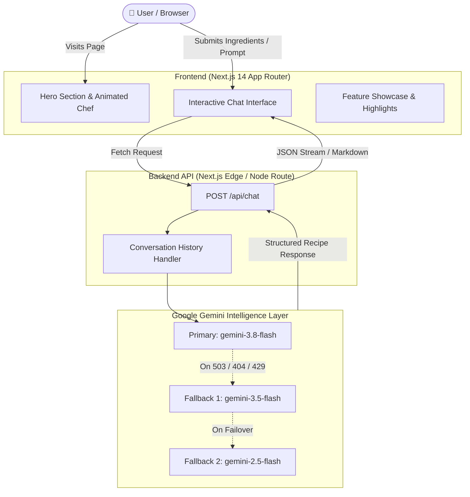

<div align="center">

# 🍳 Recipe Agent

### *Intelligent Culinary Assistant Powered by Google Gemini AI*

An AI-driven recipe generation platform built with **Next.js 14**, **Google Gemini AI**, **Framer Motion**, and **Tailwind CSS**. Crafted with a dark-mode glassmorphic aesthetic, interactive culinary animations, and resilient multi-model failover.

<br />

[](https://nextjs.org/)
[](https://www.typescriptlang.org/)
[](https://tailwindcss.com/)
[](https://ai.google.dev/)
[](https://www.framer.com/motion/)
[](LICENSE)

<br />

[Explore Features](#-features) • [Quick Start](#-quick-start) • [Architecture](#-architecture) • [Tech Stack](#-tech-stack) • [Contributing](#-contributing)

---

</div>

## 🌟 Overview

**Recipe Agent** is designed to eliminate mealtime decision fatigue. Whether you have random ingredients left in your pantry, specific dietary constraints (Keto, Vegan, Gluten-Free), or cravings for international cuisines, Recipe Agent formulates structured, easy-to-follow culinary guides with exact measurements, nutritional insights, and chef tips.

---

## ✨ Features

- 👨‍🍳 **Dynamic Animated Chef Hero**: Vector-based physics animation featuring an animated chef tossing fresh ingredients in a hot skillet with sizzling flame effects and steam wisps.
- ⚡ **Resilient Gemini AI Engine**: Integrated with Google Gemini models featuring an automatic fallback chain (`gemini-3.8-flash` → `gemini-3.5-flash` → `gemini-2.5-flash`) to ensure 99.9% uptime during API peak hours.
- 💬 **Conversational Recipe Assistant**: Real-time multi-turn chat with contextual recipe memory, quick-start prompt pills, and markdown-formatted recipes.
- 🎨 **Glassmorphism & Micro-Interactions**: Ambient glowing orbs, frosted glass layers, gradient borders, and smooth transitions powered by Tailwind CSS & Framer Motion.
- 🥗 **Dietary & Cuisine Flexibility**: 50+ global cuisines supported with dietary adjustments (Gluten-Free, Dairy-Free, Low-Carb, High-Protein, Vegan).
- 📱 **Fully Responsive**: Optimized for desktop, tablet, and mobile browsers with native viewport adaptation.

---

## 🏗️ Architecture



---

## 🛠️ Tech Stack

| Category | Technology | Description |
| :--- | :--- | :--- |
| **Framework** | [Next.js 14](https://nextjs.org/) | React framework with App Router, SSR, and API endpoints |
| **Language** | [TypeScript 5](https://www.typescriptlang.org/) | End-to-end type safety |
| **Styling** | [Tailwind CSS 3](https://tailwindcss.com/) | Modern utility-first CSS framework |
| **Motion** | [Framer Motion](https://www.framer.com/motion/) | Production-grade animations and spring transitions |
| **AI SDK** | [@google/generative-ai](https://ai.google.dev/) | Official Google Generative AI Node.js SDK |
| **Markdown** | [React Markdown](https://github.com/remarkjs/react-markdown) | Formatted recipe presentation with custom typography |
| **Icons** | [Lucide React](https://lucide.dev/) | Consistent, clean icon collection |

---

## 🚀 Quick Start

### Prerequisites

Ensure you have installed:
- **Node.js**: `v18.17.0` or later
- **npm** (or `yarn` / `pnpm`)
- A **Google Gemini API Key** from [Google AI Studio](https://aistudio.google.com/app/apikey)

### 1. Clone the Repository

```bash
git clone https://github.com/tanmaykatiyar0207-cell/Recipe-Agent-.git
cd Recipe-Agent-
```

### 2. Install Dependencies

```bash
npm install
```

### 3. Configure Environment Variables

Create a local `.env.local` file by copying the example:

```bash
cp .env.example .env.local
```

Open `.env.local` and add your API key:

```env
# Google Gemini API Key
GEMINI_API_KEY=your_gemini_api_key_here
```

### 4. Run the Development Server

```bash
npm run dev
```

Open [http://localhost:3000](http://localhost:3000) in your browser to start cooking with your AI agent!

---

## 📁 Project Structure

```text
recipe-agent/
├── src/
│   ├── app/
│   │   ├── api/
│   │   │   └── chat/
│   │   │       └── route.ts          # API Route: Gemini prompt execution & history
│   │   ├── globals.css               # Design tokens, custom animations & styles
│   │   ├── layout.tsx                # Base layout with Google fonts & metadata
│   │   └── page.tsx                  # Landing page composition
│   ├── components/
│   │   ├── ChatInterface.tsx         # Chat UI, prompt suggestions & markdown parser
│   │   ├── Features.tsx              # Grid showcase of agent capabilities
│   │   ├── Footer.tsx                # Animated footer with repository links
│   │   ├── Hero.tsx                  # Parallax hero section with CTAs
│   │   ├── Navbar.tsx                # Glassmorphic navigation header
│   │   └── SplineScene.tsx           # Vector animated chef with pan-tossing physics
│   └── lib/
│       └── gemini.ts                 # Gemini client config, prompt & fallback chain
├── .env.example                      # Template for environment variables
├── .gitignore                        # Git exclusion rules (safeguarding API keys)
├── LICENSE                           # MIT License
├── next.config.mjs                   # Next.js configuration
├── package.json                      # Dependencies and project scripts
├── postcss.config.js                 # PostCSS setup for Tailwind CSS
├── tailwind.config.ts                # Theme extensions, keyframes & animations
└── tsconfig.json                     # TypeScript compiler options
```

---

## 🧪 Available Scripts

| Script | Command | Description |
| :--- | :--- | :--- |
| **Dev** | `npm run dev` | Starts local Next.js dev server on port `3000` |
| **Build** | `npm run build` | Compiles production-optimized build |
| **Start** | `npm run start` | Boots the compiled production server |
| **Lint** | `npm run lint` | Runs Next.js ESLint checks |

---

## 💡 Example Prompts to Try

- *"I have eggs, spinach, cherry tomatoes, and feta cheese. What can I make in under 15 minutes?"*
- *"Give me a high-protein vegan dinner recipe with lentils and sweet potatoes."*
- *"Teach me how to make authentic Neapolitan pizza dough with hydration percentages."*
- *"What's a healthy swap for heavy cream in an Alfredo pasta sauce?"*

---

## 🛡️ Security & Best Practices

- **API Key Isolation**: The `GEMINI_API_KEY` is loaded exclusively on the server side via Next.js Route Handlers (`/api/chat`). It is never exposed to the client bundle.
- **Git Hygiene**: `.env*.local` is explicitly ignored in `.gitignore` to prevent credential leakage.

---

## 🤝 Contributing

Contributions, issues, and feature requests are welcome!

1. Fork the repository
2. Create your feature branch (`git checkout -b feature/amazing-feature`)
3. Commit your changes (`git commit -m 'feat: add amazing feature'`)
4. Push to the branch (`git push origin feature/amazing-feature`)
5. Open a Pull Request

---

## 📄 License

This project is licensed under the MIT License — see the [LICENSE](LICENSE) file for details.

<div align="center">
  <sub>Crafted with passion for good food & intelligent agents. Powered by Google Gemini AI.</sub>
</div>
